在当今的数据分析场景中，复杂图查询的优化始终是业界面临的一项挑战。GOpt 是面向复杂图查询的优化框架，在 [SIGMOD Industry 2025](https://arxiv.org/abs/2401.17786) 上正式介绍。它的核心目标是提供高效、通用的优化方案，适配不同的图查询语言和执行引擎。本文将介绍 GOpt 在统一图查询优化方面的关键创新，并结合 [LDBC SNB](https://ldbcouncil.org/benchmarks/snb) 中的具体查询，分析其优化过程。

GOpt 在以下方面取得了突破：

- **无缝支持主流图查询语言**：兼容 [Cypher](https://neo4j.com/docs/cypher-manual/current/introduction) 和 [Gremlin](https://tinkerpop.apache.org)，并计划进一步支持图查询标准 [GQL](https://www.gqlstandards.org)。
- **统一优化复杂模式**：深入优化三角形、路径、方形、团等复杂模式。图 1 展示了 GOpt 支持的多种复杂模式。

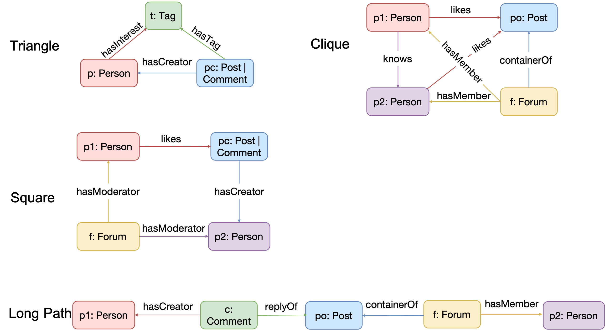

*图 1：GOpt 支持的复杂模式。*

- **支持 Cypher 查询的多模式特性**：首先按照 Cypher 语义，将多个模式之间的关系表示为 Inner、Left 或 Anti Join，把模式之间的优化转化为连接优化，直接复用关系数据库中成熟的连接优化规则。图 2 展示了 GOpt 支持的多模式查询及其内部表示。

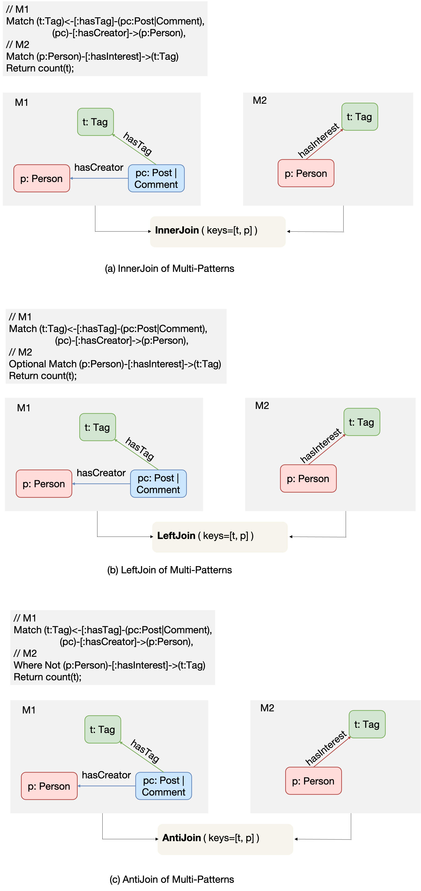

*图 2：GOpt 支持的多模式查询。*

- **对接主流图查询执行引擎**：在此前的文章 [Revolution: Enhancing Neo4j Efficiency with GOpt](https://mp.weixin.qq.com/s/07w8YaH0VmhgJXJkDN0KUg) 中，我们将 GOpt 集成到了 Neo4j。图 3 比较了 Neo4j 原生执行计划和 GOpt 优化后计划的执行效果。在 [LDBC SNB](https://ldbcouncil.org/benchmarks/snb) 标准测试集中，IC 和 BI 分别代表交互式复杂查询与商业智能查询，GOpt 为 Neo4j 带来了平均 15.8 倍的性能提升。我们还将 GOpt 集成到 GraphScope，相比其内置的规则优化器，查询性能平均提升了 243.4 倍。

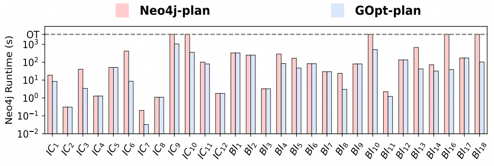

*图 3：Neo4j 上 LDBC 查询的耗时。*

本文将围绕前三点进一步介绍 GOpt 的优化流程，通过 LDBC SNB 标准查询直观展示优化过程。对于第四点，GOpt 设计了专门的 Physical Converter 层。由于这部分更偏向底层实现，我们计划在后续文章中进一步介绍“如何将 GOpt 集成到 Neo4j”和“如何将 GOpt 集成到 DuckDB”。

## 优化流程

图 4 展示了 GOpt 的系统架构，主要分为三层：

1. **Query Parser（查询解析器）**：首先使用 [Antlr](https://www.antlr.org) 对 Cypher 或 Gremlin 查询进行语法检查，再通过 GIRBuilder 工具将 Antlr AST 转换为初始 GIR 结构。
2. **GIR Optimizer（GIR 优化器）**：基于 GIR 进行优化，对输入结构执行变换，输出优化后的 GIR。根据变换的实现方式，可以采用启发式规则或自顶向下搜索。
3. **Physical Convertor（物理计划转换器）**：将物理执行计划进一步转换为后端引擎能够执行的代码。

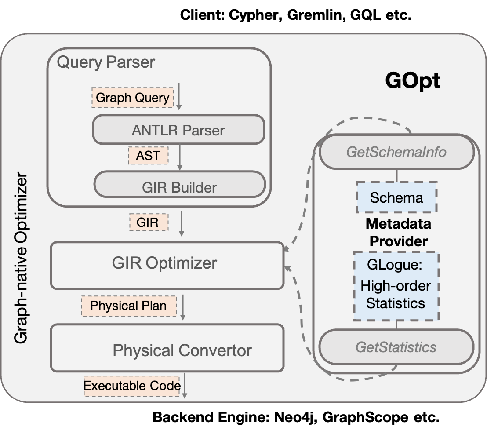

*图 4：GOpt 系统架构。*

### GIR 结构

GIR（Graph Intermediate Representation，图中间表示）是一种与具体图查询语言无关的中间数据结构，包含数据模型定义，以及操作这些模型的一组算子。

GIR 的数据模型由图数据类型和基础数据类型构成。图数据类型包括 Vertex（顶点）、Edge（边）、Path（路径）等；基础类型包括 Integer、Float、String，以及 Array、Map、Set 等复合类型。GIR 采用关系数据库中的数据格式：每个元组包含多个字段，每个字段具有名称和值，值既可以是图数据类型，也可以是基础类型。

GIR 的算子分为图算子和关系算子。

图算子定义查询获取图数据的方式，包括：

1. **GET_VERTEX**：从图数据库获取顶点数据源，或从输入边中获取端点。
2. **EXPAND_EDGE**：从图数据库获取边数据源，或从输入顶点扩展相邻边。
3. **EXPAND_PATH**：从输入顶点扩展由多条边组成的路径。
4. **MATCH_PATTERN**：统一表达 Cypher 或 Gremlin 的 Match 子句。在 GIR 中有两种等价表示：一种是由上述图算子构成的复合结构，以 `MATCH_START` 和 `MATCH_END` 标识起止；另一种是基于 [JGraphT](https://jgrapht.org) 的图结构。两者可以相互转换。图 5(c) 展示了左侧查询的 Match 子句在两种形式下的统一表示。

关系算子包括 Filter、Sort、Limit、Unfold、Project、Group、Join 和 Union。GOpt 对这些算子的支持与传统数据库一致，这里不再展开。图 5(a) 的 Cypher 查询和图 5(b) 的 Gremlin 查询，都可以统一表示为图 5(c) 中的 GIR 结构。

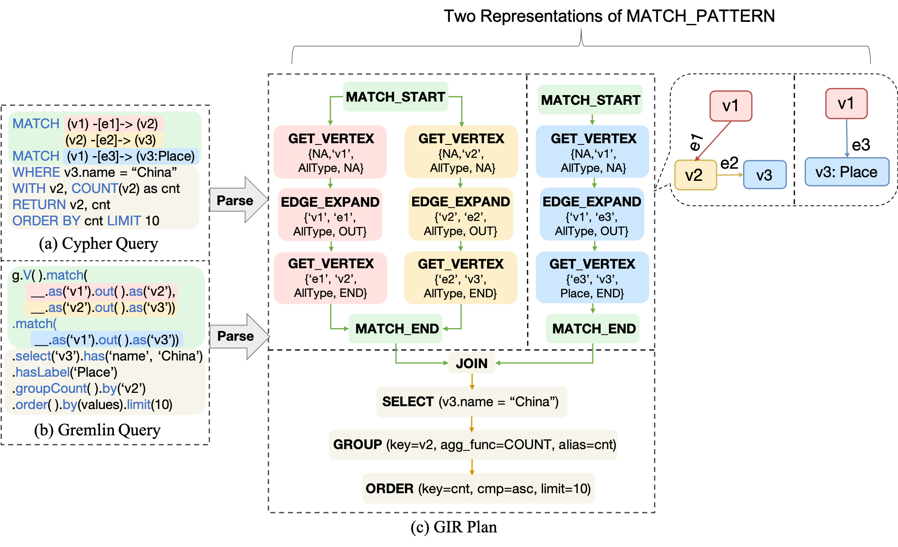

*图 5：查询示例的 GIR 表示。*

## 优化策略

接下来介绍 GOpt 如何基于 GIR 优化查询。GIR Optimizer 的整个优化过程可以表示为有向无环图（DAG）。每个节点代表一个 Strategy（策略），用于执行一条或多条规则；边表示规则执行的先后关系。GOpt 按照 DAG 的拓扑顺序执行规则。图 6 展示了已实现的策略及其依赖关系。

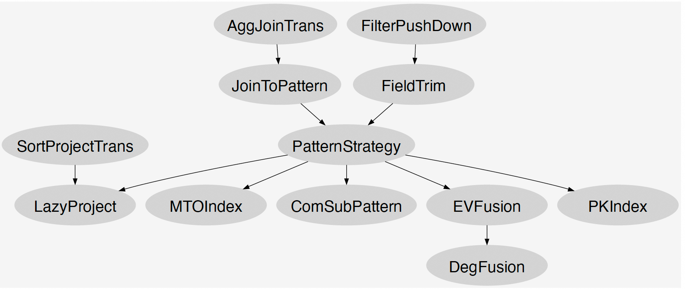

*图 6：GOpt 优化流程的 DAG。*

Strategy 的接口定义如下：

```java
interface Strategy {
    GIRPlan transform(GIRPlan input);
}
```

基于该接口，GOpt 提供两类实现：RuleBasedStrategy 和 PatternStrategy。

**RuleBasedStrategy** 包含一系列启发式规则。每条规则实现 `transform` 函数，对输入 GIRPlan 进行等价变换并输出结果。部分规则复用自 Calcite，包括 FieldTrim、SortProjectTrans 和 AggJoinTrans。此外，针对图数据模型与图操作，GOpt 实现了 FilterIntoPattern、JoinToPattern、ComSubPattern、EVFusion、DegFusion、PKIndex 和 LateProject 等专用规则。

**PatternStrategy** 主要优化模式内部图算子的执行顺序，即 PatternOrder。`transform` 方法接收由 `MATCH_PATTERN` 和其他关系算子组成的逻辑 GIRPlan（图 7(a)），输出由一系列物理算子构成的 PatternOrder，也就是物理 GIRPlan（图 7(b)）。它执行 [GOpt 论文](https://arxiv.org/abs/2401.17786) 中的自顶向下搜索算法，得到多个候选 PatternOrder 及其代价，并选择代价最低的计划作为输出。

最后，Physical Convertor 将物理 GIRPlan 转换为各执行引擎支持的执行计划。例如，在 GraphScope 中，`Expand(v1->v2, v3->v2)` 被转换为 ExpandIntersect 实现，如图 7(c)；在 Neo4j 中，该算子被转换为 ExpandInto 实现，如图 7(d)。

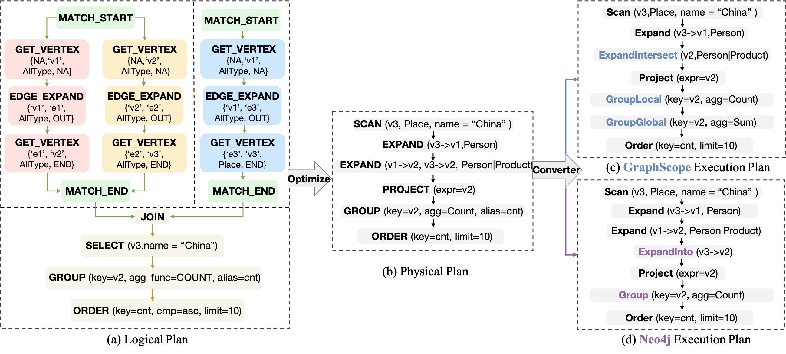

*图 7：查询示例的优化与物理转换。*

# 案例分析

我们从 LDBC SNB 中选择了一个包含复杂模式、多模式和聚合计算的查询，这些都是常见的优化需求。图 8 和下方 Cypher 代码描述了这个查询。

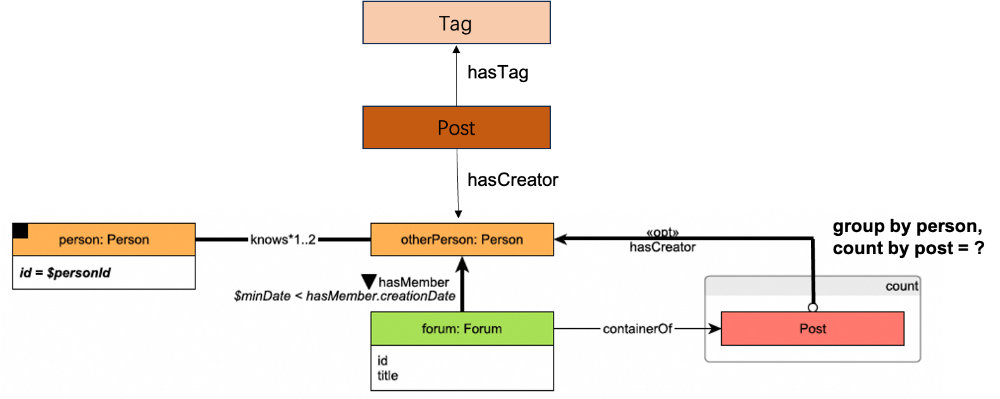

*图 8：查询案例说明。*

```cypher
// M1
MATCH (person:PERSON)-[:KNOWS*1..3]-(otherP),
      (otherP)<-[membership:HASMEMBER]-(forum)

// M2
MATCH (otherP)<-[:HASCREATOR]-(post)<-[:CONTAINEROF]-(forum)

// M3
MATCH (otherP)<-[:HASCREATOR]-(:POST)-[:HASTAG]->(tag:Tag)

// Filter
WHERE person.id = $personId
      AND otherP <> $personId
      AND membership.joinDate > $minDate

// Aggregate
RETURN otherP, count(post) AS post_cnt;
```

GOpt 首先通过 Query Parser 将 Cypher 查询转换为 GIR，如图 9。M1、M2 和 M3 构成初始 Join 结构，其后是一系列关系操作。

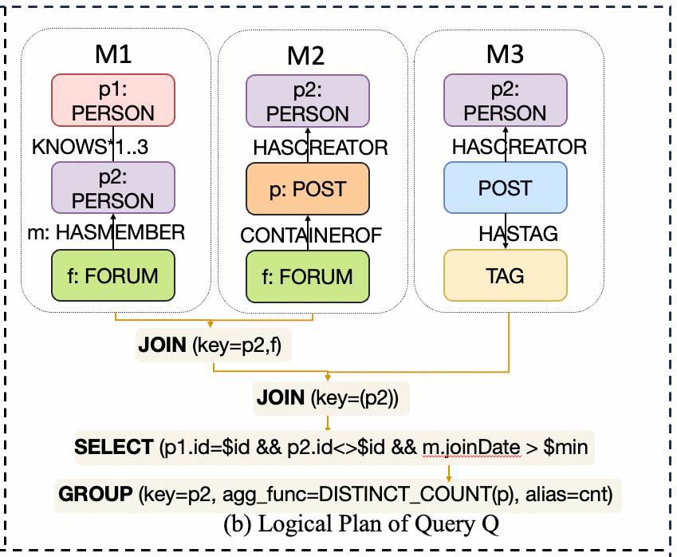

*图 9：查询案例的初始 GIR。*

随后，GIR Optimizer 按照 DAG 中定义的策略对 GIR 进行优化。图 10 高亮标出了在此查询中生效的策略。

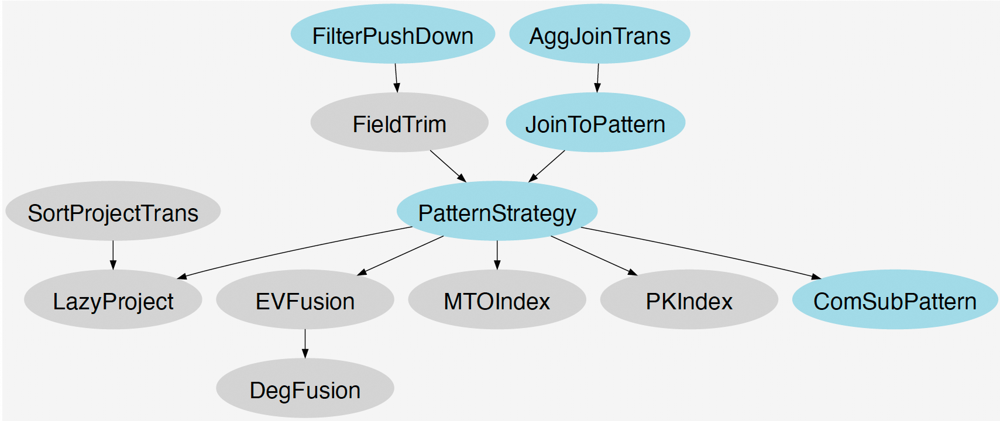

*图 10：查询案例的优化流程 DAG。*

## 优化规则

下面进一步解释适用于该查询的规则：

- **FilterIntoPattern**：在 Calcite 的 FilterIntoJoin 基础上扩展，将过滤条件进一步下推到模式内部的图算子。例如：

    ```cypher
    MATCH (v1)-[e1]->(v2),
        (v2)-[e2]->(v3),
        (v1)-[e3]->(v3)
    // There is a <Join> between the two patterns in GIR
    MATCH (v1)-[e4]->(v4)
    WHERE v3.name = "China"
    RETURN v1.name, count(v2);
    ```

    应用规则后，优化后的查询等价于：

    ```cypher
    MATCH (v1)-[e1]->(v2),
        (v2)-[e2]->(v3 {name: 'China'}),
        (v1)-[e3]->(v3 {name: 'China'})
    // There is a <Join> between the two patterns in GIR
    MATCH (v1)-[e4]->(v4)
    RETURN v1.name, count(v2);
    ```

- **AggJoinTrans**：将聚合运算下推到 Join 算子。该规则借鉴自[关系数据库](https://calcite.apache.org/javadocAggregate/org/apache/calcite/rel/rules/AggregateJoinTransposeRule.html)。
- **JoinToPattern**：移除模式之间的 Join，将左右子模式合并为一个统一模式。是否能够合并，取决于合并前后语义是否一致。根据不同查询语言的要求，模式内部可以具有以下语义：
    - **同态语义（Homomorphism）**：允许顶点和边重复，Gremlin 采用这种语义。
    - **边不重复语义（Edge-Distinct）**：允许顶点重复，但不允许边重复，Cypher 采用这种语义。
    - **顶点不重复语义（Vertex-Distinct）**：允许边重复，但不允许顶点重复。
    - **顶点和边均不重复语义（Vertex-Edge-Distinct）**：顶点和边都不允许重复。

    两个模式之间的 Join 本质上表达同态语义，因此该规则只能在满足这一前提时应用。

- **PatternStrategy**：如前文所述，对输入模式执行自顶向下搜索，根据代价选择最优 PatternOrder。
- **ComSubPattern**：提取参与 Join 的两个子模式的公共部分，作为共享的输入数据。如果公共部分只有一个顶点，可以进一步将 Join 优化为 Expand。

## 优化过程

GIR Optimizer 按照图 10 的顺序，依次执行以下策略：

- **首先执行 FilterIntoPattern**：将过滤条件 `{person.id = $personId, otherP <> $personId, membership.joinDate > $minDate}` 下推到分别生成 `person` 顶点、`otherP` 顶点和 `membership` 边的图算子。

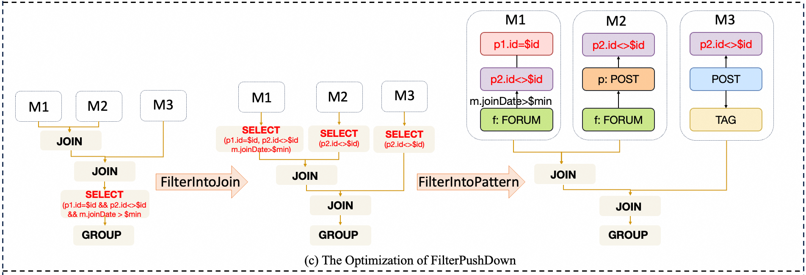

*图 11：FilterIntoPattern 的优化效果。*

- **接着执行 AggJoinTrans**：拆分与 `{otherP, count(post) as post_cnt;}` 相关的分组操作，一部分下推到 Join 左侧分支，另一部分保留在 Join 之后，对此前计算的分组结果求和，以保证语义等价。

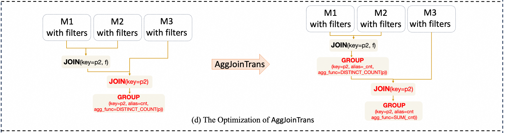

*图 12：AggJoinTrans 的优化效果。*

- **随后执行 JoinToPattern**：移除 M1 和 M2 之间的 Join，将它们合并为统一模式 M4。本例假设模式符合该规则要求的同态语义。

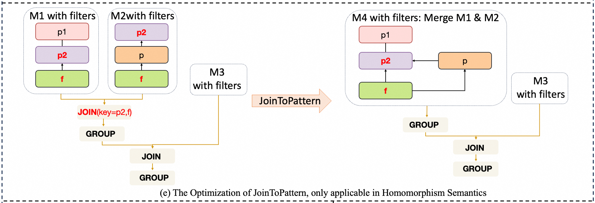

*图 13：JoinToPattern 的优化效果。*

- **执行 PatternStrategy**：下图展示输出的最优模式顺序，由一系列物理算子构成。

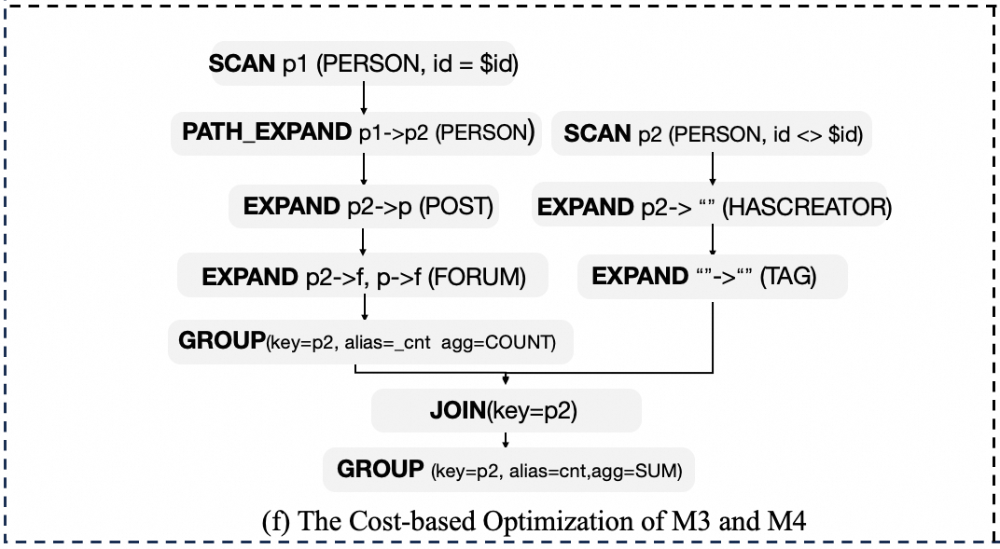

*图 14：M3 和 M4 中 PatternStrategy 的优化效果。*

- **最后执行 ComSubPattern**：优化模式之间可复用的公共结果。如图 14，Join 左侧分支的 M4 在 Group 后输出两列 `(p2, _cnt)`；右侧 M3 优化后的 PatternOrder 则以 `Scan p2(PERSON, id <> $id)` 开始。由于公共部分只有顶点 p2，根据 ComSubPattern 规则，可以进一步将 Join 优化为 Expand。因此，M3 直接从 Group 输出的 p2 继续执行 `Expand p2->"" (HASCREATOR)`。

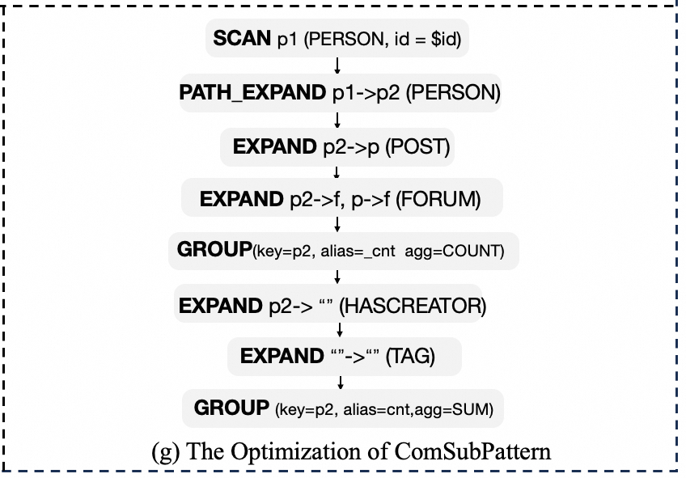

*图 15：M3 和 M4 之间 ComSubPattern 的优化效果。*

## 实验结果

针对上述案例，我们主要进行了消融实验和模式顺序对比实验，使用的数据集为 LDBC<sub>100</sub>，如表 1。

| 图 | \|V\| | \|E\| | 大小 |
| ----- | ----- | ----- | ----- |
| sf100 | 283M | 1754M | 156GB |

*表 1：LDBC<sub>100</sub> 数据集。*

系统部署在单个节点上，配置如下：

- 8 核 Intel Xeon E5-2620 v4 CPU，主频 2.1GHz。
- 512GB 内存。
- 10Gbps 网络。

使用 [GraphScope v0.29.0](https://github.com/alibaba/GraphScope/releases/tag/v0.29.0)，底层执行引擎为 [GAIA](https://github.com/alibaba/GraphScope/tree/main/interactive_engine/executor/engine/pegasus)，使用 32 个线程。

消融实验主要比较 FilterIntoPattern、AggJoinTrans、JoinToPattern 和 ComSubPattern 各条规则的优化效果。为避免规则间的相互干扰，我们按照图 10 的顺序逐条加入规则，比较每次加入后的执行时间，结果如表 2。

| 规则 | 耗时（ms） |
| ------------------ | -------------- |
| 无优化 | 770573 |
| +FilterIntoPattern | 234313 |
| +AggJoinTrans | 214955 |
| +JoinToPattern | 64466 |
| +ComSubPattern | 7014 |

*表 2：查询案例的消融实验耗时。*

模式顺序实验将 PatternStrategy 生成的最优顺序与另外两个随机选择的顺序进行比较。图 16 展示三种模式顺序的执行步骤，并标注各步骤实际产生的中间数据量。表 3 比较三种顺序的执行时间。

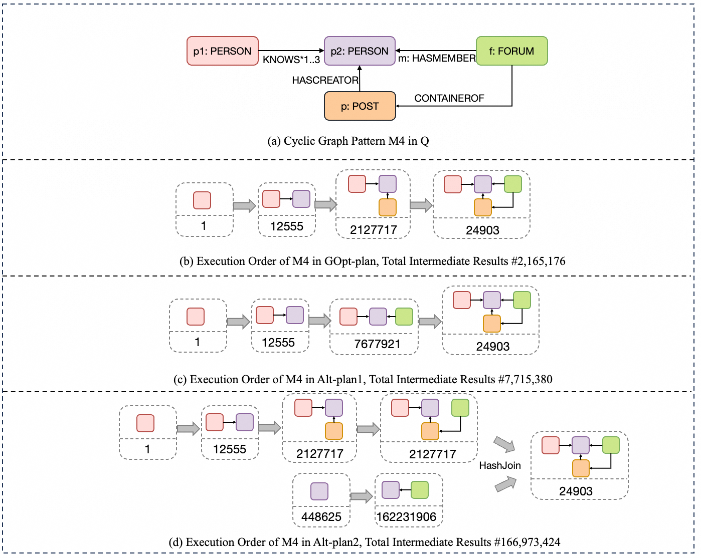

*图 16：GOpt-plan、Alt-plan1 和 Alt-plan2 的模式顺序。*

| 计划 | 耗时（ms） |
| --------- | -------------- |
| GOpt-plan | 7014 |
| Alt-plan1 | 22211 |
| Alt-plan2 | 194047 |

*表 3：查询案例中不同模式顺序的耗时。*

## 致谢

转载自 [GraphScope 博客](https://graphscope.io/blog/tech/2025/03/25/GOpt-Optimization-Process)。
