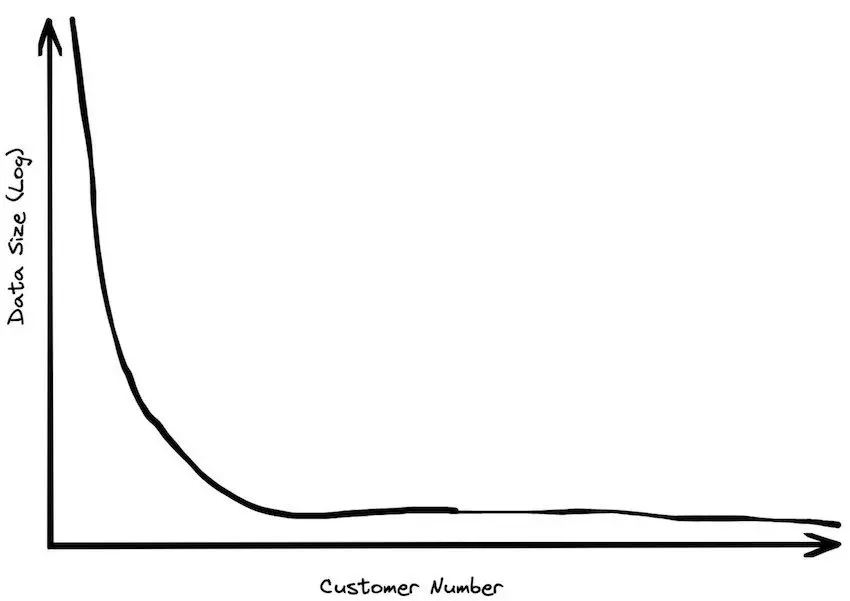
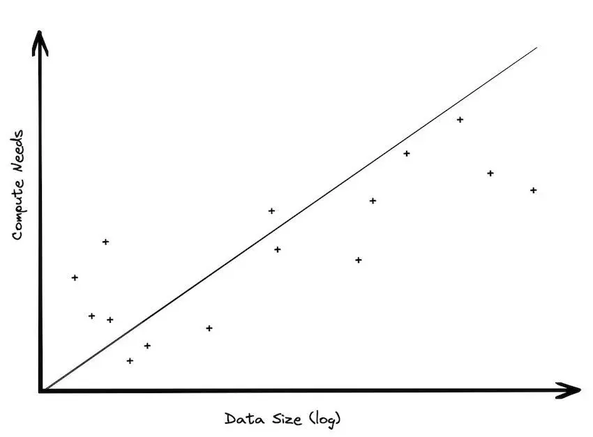
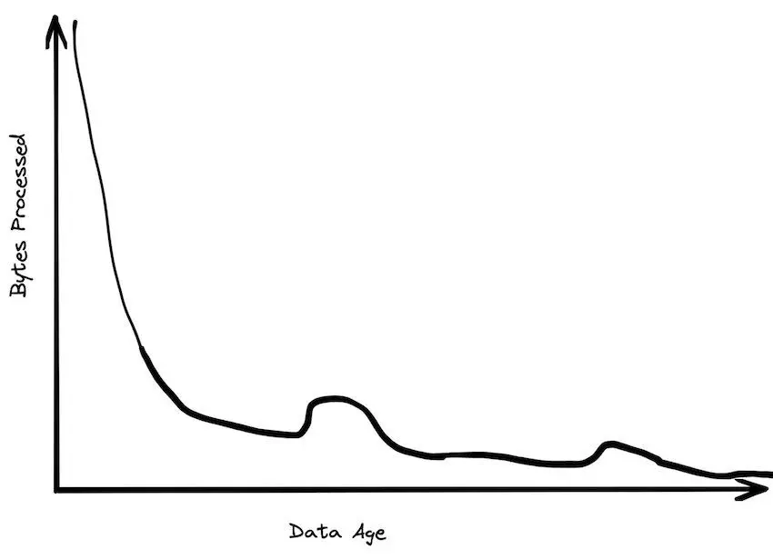
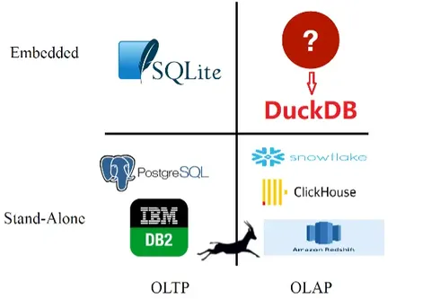
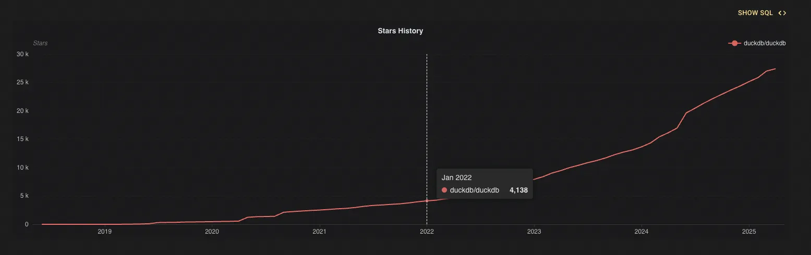
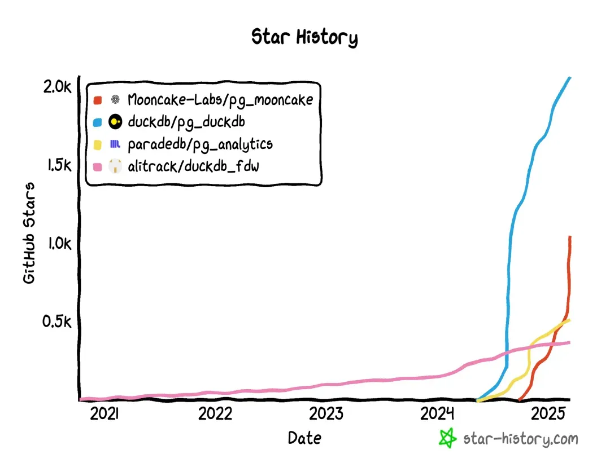
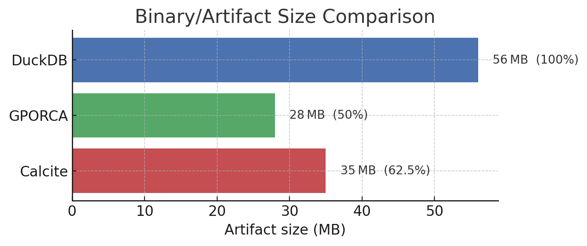

# 要点速览

- 数据库虽然历史悠久，仍然能为大语言模型的发展提供启发。
- **DuckDB 的成功公式**：洞察趋势 + 持续专注于核心能力 + 极致的产品体验。
- 人人都认同“大数据”，但并非人人都需要“大数据”。
- [“大数据已死”](https://motherduck.com/blog/big-data-is-dead/)，大模型正在成为一种更好的计算范式。
- 初期技术选型要细致，以数据指导决策，不要盲从权威。
- 技术选择始终应当服务于产品。
- 看似“小而美”的产品，其实是长期积累的结果。

---

# 引言

已经是 2025 年了，还有谁关心数据库？答案是：**每一个认真对待数据的人**。关系数据库自 20 世纪 70 年代诞生以来，一直是数据管理的支柱。尽管经历了 NoSQL、NewSQL 等一波波浪潮，传统数据库与 SQL 的主导地位依然稳固。在 SIGMOD 2023 上，SQL 的共同创造者 Don Chamberlin 发表了题为 [“49 Years of Queries”](https://dl.acm.org/doi/10.1145/3555041.3589336) 的主题演讲，回顾关系数据库与 SQL 近半个世纪的发展。他强调，数据库系统的长久生命力来自 E. F. Codd 奠定的基础理论，例如：

- **[数据库规范化](https://en.wikipedia.org/wiki/Database_normalization)**：指导我们以结构化方式组织数据，消除冗余。
- **自然语言查询**：从 Codd 在 1974 年的 [Rendezvous](https://dl.acm.org/doi/10.1145/1045283.1045298) 项目起就开始追求的愿景，也推动了 SQL 的发展。
- **[关系代数的封闭性](https://en.wikipedia.org/wiki/Relational_algebra)**：确保链式操作之间采用统一的数据格式。

55 年过去，大模型主导了人工智能领域，非结构化数据处理迅速增长，但数据库理论仍有深远影响。规范化思想启发着大语言模型的训练，产生了 [“Data Quality is All You Need”](https://arxiv.org/pdf/2307.09288) 这样的主张。自然语言查询终于借助大模型蓬勃发展，尽管有时热情似乎过了头。智能体系统的开发者也逐渐意识到，[封闭性与标准化](https://medium.com/@kyeg/unlocking-structured-outputs-with-agents-8b5a564b5d44) 对端到端稳定执行的重要性。

在不断变化的技术世界里，数据库是少见的稳定领域：热闹的潮流不断更替，**基础原理却经久不衰**。对于数据库产品，做好正确性、可靠性与效率这些基本功始终最重要。这并不意味着停滞；扎实的基础反而使我们能够更从容地应对趋势。[DuckDB](https://duckdb.org/) 就是将趋势洞察与技术深度结合起来的例子。本文讨论它的团队如何在**创新与基础之间取得平衡**，打造有竞争力的产品。

---

# 市场趋势

2023 年，MotherDuck 创始人 Jordan Tigani 的文章 [“Big Data is Dead”](https://motherduck.com/blog/big-data-is-dead/) 引发广泛讨论，也清楚解释了 DuckDB 采用嵌入式、轻量级、单进程设计的原因。

## 打破“大数据神话”的三个事实

- **大多数组织的数据并不“大”**。投资者的调查显示，即使大型 B2B 公司管理的也往往只是 TB 级数据，很多公司的数据规模只有 GB 级。SingleStore 等公司的内部数据表明，核心数据集常常只有个位数 GB。**对于多数用户，数据规模不是瓶颈。**



- **存储与计算不平衡**。现代架构将存储与计算分离，但存储规模持续线性增长，计算需求却没有同步增长。大多数分析集中在近期数据，大量历史数据利用率很低。这种对存储的执着，为很少访问的数据带来了持续维护成本。



- **数据价值快速衰减**。业务数据往往在数周后就失去时效性。历史数据更多服务于审计或模型训练，而非日常分析。**“大数据”是少数 1% 用户的游戏**，多数用户的需求仍在传统单机能力范围内。



## 纵向扩展的回归

“大数据”时代兴起时，横向扩展（分布式集群）比纵向扩展（更强的单机）便宜。如今，硬件进步正在改变这一关系：

- **内存与存储的跃升**：DDR5 内存带宽达到 70GB/s，NVMe SSD 的延迟接近 DRAM。
- **统一架构**：苹果 M 系列芯片统一 CPU、GPU 和 NPU 的内存，显著减少数据搬移开销。

结果是，过去需要 Hadoop 或 Spark 集群的任务，现在可以在单机上高效运行。TPC-DS 基准测试显示，在 100GB 数据集上，DuckDB 的性能比 Spark 高出 3–8 倍，能效提高约 10 倍。

## 大模型与大数据

大数据分析热度下降的另一个重要原因，是计算范式正在从“大数据”逐步转向“大模型”。随着大语言模型成为新的技术基石，传统大数据技术栈的重要性也在被重新评估。大型预训练模型本质上是对海量数据的[**压缩与提炼**](https://arxiv.org/pdf/2309.10668)。过去需要费力分析数 TB 数据才能得到的知识，现在已经融入模型中。当人们越来越多地通过询问 GPT-4 等模型获取信息，而不是对日志或数据仓库执行复杂查询时，底层数据处理与计算范式也必然随之简化。

在这样的背景下，DuckDB 一类嵌入式数据库迎来了机会。例如，DeepSeek 的 [smallpond](https://github.com/deepseek-ai/smallpond) 就使用 DuckDB 实现轻量、高性能的数据处理。

## DuckDB 的崛起

DuckDB 的起点与大数据热潮背道而驰，源于一个简单的观察：没有人在做嵌入式分析数据库。下图展示了其创造者看到的市场空白。



DuckDB 诞生于 2018 年，在 2022 年迎来爆发式增长，到 2025 年已经成为分析处理数据库领域的重要领跑者。这对于一个嵌入式数据库而言，是前所未有的发展速度。



---

# 出色的产品能力

DuckDB 的成功不仅在于抓住趋势，其出色的产品能力同样功不可没。它的功能值得长篇讨论，这里先介绍最令人印象深刻的几项。

## 零拷贝数据访问

DuckDB 无需导入数据，就能查询 CSV、Parquet 等外部文件。向量化执行引擎与列式格式支持高效扫描，也能利用 HTTP Range 请求按需读取部分数据。例如：

```sql
SELECT * FROM 'data.parquet';
```

查询也能直接运行在 Pandas DataFrame 或 Arrow 数据上，避免数据重复。这种“瑞士军刀”般的灵活性十分契合数据科学家的工作流。

查询能够直接访问 Pandas DataFrame 或 Arrow 数据，不必复制数据。**这种“瑞士军刀”般的多功能性，与数据科学家的工作流高度一致。**

## HTTPFS 扩展

受 PostgreSQL 设计启发，DuckDB 从一开始就把可扩展性作为核心能力。HTTPFS 是其中非常巧妙的一项：它支持直接访问 HTTP(S) 地址与 S3 等云对象存储，只需一个 URL，就能像查询本地表一样查询远程数据。

例如：

```sql
SELECT count(*)
FROM 'https://example.com/dataset/file.parquet';
```

DuckDB 通过 HTTP 自动获取所需的文件片段。对于 Parquet 等列式格式，它还会进一步只读取需要的列，显著提高效率。

这一能力与大数据范式形成互补：用户可以把大型数据集保留在云端，只取回相关子集在本地分析，甚至与已有的本地数据进行连接。

在这一典型的**端云协同场景**中，DuckDB **无需复杂中间件**便能实现临时性的云端数据分析，简化数据工程工作流。这不正是数据湖原本承诺的使用方式吗？

## 巧妙的 HTAP 策略：连接 OLTP 与 OLAP

### HTAP 的“陷阱”

[HTAP（混合事务与分析处理）](https://en.wikipedia.org/wiki/Hybrid_transactional/analytical_processing) 希望在一个数据库中同时提供 TP 与 AP 能力。它给事务型和分析型数据库都提供了拓展业务场景的机会，也成为数据库市场的激烈竞争领域。但 HTAP 真有那么好吗？无论从 TP 扩展到 HTAP，还是反过来，都可能落入这个看似甜美的陷阱：

- **存储与计算诉求不一致**：OLTP 依赖行存支持高并发事务，OLAP 则需要列存加速聚合。强行融合往往要同时维护两套存储引擎，例如行存副本与列存副本，导致数据同步与一致性维护成本大幅上升。
- **资源竞争与性能下降**：OLTP 的短事务需要毫秒级响应，OLAP 的长查询可能持续数分钟，两者会竞争 CPU、内存和 I/O。
- **技术侧重点冲突**：OLTP 强调 ACID 事务与行锁，OLAP 对一致性的要求相对宽松。例如，分析查询的全表扫描可能触发行存的锁竞争，阻塞事务操作。

### 为什么不借助成熟系统？

DuckDB 的思路是：与其让一个系统强行包办，不如让擅长事务和擅长分析的系统各展所长，再把两者连接起来。于是，TP 和 AP 领域中可扩展性出色的 PostgreSQL 与 DuckDB 自然走到了一起。

一方面，DuckDB 提供 Postgres Scanner 扩展，直接连接 PostgreSQL，将其中的表映射为 DuckDB 中可查询的虚拟视图。这样，DuckDB 可以作为分析加速器，在不额外复制数据的情况下读取 PostgreSQL 的实时数据，避免双写和异步同步的复杂性。查询时，通过 PostgreSQL 的二进制协议高效读取数据，再在 DuckDB 中执行分析逻辑。

```sql
SELECT * FROM postgres_scan('dbname=myshinydb', 'public', 'mytable');
```

另一方面，PostgreSQL 生态也出现了借助 DuckDB 增强分析能力的扩展，其中包括 DuckDB 团队推出的 pg_duckdb。



在 [pg_duckdb](https://github.com/duckdb/pg_duckdb) 的实现中，DuckDB 通过与 PostgreSQL 的逻辑时间戳对齐，使分析查询基于事务数据库最新的一致性快照，避免脏读与幻读。此外，它使用 Postgres Scanner 直接访问 PostgreSQL 的行存表，再由向量化引擎执行 OLAP 查询，在无需复制数据的情况下提升 AP 性能。例如，第三方 TPC-H 测试显示，相比原生 PostgreSQL，pg_duckdb 对复杂分析查询实现了[超过 1000 倍的性能提升](https://mp.weixin.qq.com/s?__biz=MzIzOTA2NjEzNQ==&mid=2454788670&idx=1&sn=24a3d2f17b8ad32dd7baed15598c4e28&chksm=ff377ebf7a2bfdf64db0980eddcdea4d586ee40f22ec68b865a5d3c464fcd7e745621b811583#rd)。

**PostgreSQL 与 DuckDB 的可扩展性，解耦了 OLTP 与 OLAP 的技术矛盾：PostgreSQL 专注于订单处理等事务，DuckDB 专注于实时报表等分析，两者通过进程内联邦查询，而非复制数据，实现逻辑上的统一。**

### GraphScope 的尝试

说到这里，我也想起 GraphScope 曾尝试在 OLTP 数据库基础上扩展图分析能力，即 [GART 项目](https://github.com/GraphScope/GART)。遗憾的是，写作时它最近的提交已经是半年前。

GART 最初的目标，是让 OLTP 数据库成为图分析的数据源。

OLTP 数据库已经具备成熟的数据管理能力。在多数企业应用中，清洗后的数据首先落入 OLTP 数据库，例如蚂蚁集团的 OceanBase。让 GraphScope 专注图分析，把复杂的数据管理交给成熟的 OLTP 数据库，这与“DuckDB + PostgreSQL = HTAP”的愿景十分接近。然而，在开发中，GART 尝试通过解析 Binlog 实时构图，将图分析与事务处理整合起来，也遇到了挑战：

- **架构过重**：需要维护独立的图存储与计算集群，引入 Kafka 和 GraphEngine 后，同步链路过长。
- **场景受限**：对外部数据仓库的强依赖，使轻量的嵌入式图分析难以实现。

如果采用 DuckDB 和 PostgreSQL 的设计思路，可以考虑：

- **原生图算子**：通过 PostgreSQL 扩展接口集成 libgrape-lite 或更轻量的单机并行版本，在事务数据库内部实现图遍历、社区发现等操作，避免跨系统迁移数据。
- **联邦图计算**：结合 DuckDB 的 `read_parquet`，通过 [GraphAr](https://graphar.apache.org/) 直接查询云存储中的图数据。

---

# 面向产品的极致性能

前文展示了 DuckDB 一些出色的产品能力，背后有一个共同特点：**快**。比大型 Spark 集群更快，在 OLTP 场景下也比 PostgreSQL 更快。这些性能表现来自有意识的系统设计与架构选择，例如：

- **列式存储**：分析通常只需要部分列。行存容易扫描大量无关数据，列存则只读取相关列，从而减少 I/O。
- **向量化批处理**：算子按批而不是逐行处理数据，减少函数调用开销，提高缓存利用率，并发挥现代硬件 SIMD 的并行能力。
- **零拷贝操作**：在数据转换时尽量避免内存复制。例如，[读取 Arrow 数据](https://duckdb.org/2021/12/03/duck-arrow.html) 时，DuckDB 直接操作 Arrow 内存缓冲区，也能以 Arrow 格式输出结果，实现查询引擎与 Arrow 数据的无缝衔接。
- ……

这些话题已有很多讨论。下面进一步分析 DuckDB 论文中介绍的早期设计选择。

## 计算模型

DuckDB 开发时，数据库领域主要有两种计算模型：**向量化执行**与**以数据为中心的代码生成（编译执行）**。两者在架构、性能特点和适用场景上差异明显，也都有知名系统支持：

- **向量化执行**：[VectorWise](https://ir.cwi.nl/pub/19958/19958B.pdf)、[DB2 BLU](https://www.redbooks.ibm.com/abstracts/tips1204.html)、[SQL Server 列存](https://learn.microsoft.com/en-us/sql/relational-databases/indexes/columnstore-indexes-overview?view=sql-server-ver16)、[Quickstep](https://github.com/UWQuickstep/quickstep) 等。
- **编译执行**：[HyPer](https://tableau.github.io/hyper-db/)、[Apache Spark](https://spark.apache.org/)、[Peloton](https://db.cs.cmu.edu/peloton/) 等。

公平比较这两种模型并不容易。直接比较 HyPer 与 VectorWise 等真实系统，会受到存储格式、并行策略等差异的干扰。DuckDB 团队采用了**统一实验框架**进行对照。

### 实验方法

- **统一框架**：在同一系统中分别实现编译执行模型 *Typer* 与向量化模型 *Tectorwise*，保持算法、数据结构和并行框架一致。
- **控制变量**：只改变执行引擎，排除存储压缩与优化器差异的影响。
- **跨场景验证**：通过 TPC-H、SSB 查询，分析计算密集、内存带宽敏感等不同场景下的表现。

下表总结了这篇[对比论文](https://www.vldb.org/pvldb/vol11/p2209-kersten.pdf)中的分析。

| 比较维度 | 向量化执行 | 代码生成（编译执行） | DuckDB 选择向量化的原因 |
| --- | --- | --- | --- |
| **性能特点：计算密集型负载** | 物化中间结果，执行指令较多 | 优化寄存器使用，执行指令较少 | **内存访问优化**：哈希连接与聚合等 OLAP 负载可从更少的内存等待周期中受益 |
| 内存受限场景 | 批处理隐藏缓存未命中，优化并行内存访问 | 复杂循环限制预取与乱序执行 | — |
| **工程实用性：编译开销** | 没有运行时编译，原语预先编译 | LLVM 动态编译引入延迟，复杂查询可能需要数秒 | **适合嵌入式场景**：无需等待 JIT，减少首次运行延迟 |
| 调试与性能分析 | 可单独统计选择、哈希等原语的性能 | 生成代码中的算子融合，使性能归因困难 | **方便开发者**：更容易定位优化机会 |
| **硬件兼容性：SIMD 优化** | 简单原语便于手工向量化，例如 AVX-512 带来 8.4 倍加速 | 复杂循环依赖编译器自动向量化，受限于 ICC 等条件 | **面向未来**：SIMD 利用率仍有提升潜力 |
| 多核并行 | Morsel-Driven 并行中的批次切分较均衡 | 使用同一框架，但复杂代码降低超线程效率，例如在 AMD 上收益有限 | **线程扩展性**：工作负载分配更均衡 |
| **功能扩展性：OLTP 支持** | 不适合高频单行操作 | 编译后的存储过程表现出色，适合 HTAP | **聚焦 OLAP**：DuckDB 面向分析，不追求深度 OLTP 优化 |
| 动态优化 | 支持运行时自适应，例如动态聚合 | 逻辑写入生成代码，修改后需重新编译 | **灵活性**：适应动态负载 |
| **存储协同** | 天然契合 RLE、字典编码等列式格式 | 需要类型转换或解压，增加开销 | **列式生态**：减少中间数据物化 |

因此，DuckDB 选择向量化执行，是一次**系统、全面、堪称教科书式的评估**的结果。即使向量化执行的先驱 [Peter Boncz](https://homepages.cwi.nl/~boncz/) 早期就是 DuckDB 的核心顾问，团队仍然采用了这样的评估方法。

---

## 高效的 MVCC 实现

作为面向分析负载的嵌入式数据库，DuckDB 的并发控制与传统 OLTP 数据库有本质区别。为了适应批量更新、列式操作、高压缩存储和轻量嵌入式场景，它在 [Thomas Neumann](https://en.wikipedia.org/wiki/Thomas_Neumann) 提出的 [MVCC 实现策略](https://15721.courses.cs.cmu.edu/spring2019/papers/04-mvcc2/p677-neumann.pdf) 上进行了深入优化，主要解决：

- **版本管理开销过大**：传统行级 MVCC 在批量更新时产生大量冗余版本。
- **列式压缩与更新冲突**：压缩列不能直接原地更新，需要避免频繁解压、重压缩。
- **嵌入式资源限制**：在有限内存与存储下保证事务效率。
- **分析事务特点**：长时间批处理与高并发查询需要共存。

下面总结 DuckDB 的 MVCC 设计。

### 面向分析负载的优化

- **列式批次粒度**：行级版本在批量更新时产生大量 Undo 记录，消耗内存并增加扫描成本。DuckDB 以“每 2048 行 × 每列”的版本元数据，一次记录整个批次的修改。
- **记录增量，而非旧值**：压缩页无法原地修改；Undo Buffer 仅记录修改描述，旧版本保留在原始压缩块中，尽量减少写放大。
- **降低写放大的 WAL 与检查点**：大批量导入（例如 COPY 10GB CSV）先直接写入新数据块，再在 WAL 中记录块引用；提交时原子替换数据块，回滚时将块标记为可回收，避免双写。默认 16MB 的 WAL 阈值触发自动检查点，也支持手动执行 `CHECKPOINT`；通过写入前强制 `fsync` 保证持久性。

### 轻量与嵌入式设计

- **最少元数据**：2048 行批次版本结合列式增量，在没有修改时几乎没有额外成本，内存占用只随修改量线性增长。
- **快速启动**：Undo Buffer 保存在数据页尾部，恢复时只需增量解析 WAL。在 [LazyFS](https://github.com/dsrhaslab/lazyfs) 的断电与进程终止测试中，DuckDB 经历了 4000 轮 TPC-H 刷新而没有数据丢失。
- **压缩友好**：版本信息与数据分离，原始列块保持压缩状态，不因 MVCC 反复解压或重写。
- **单机并发**：读事务不阻塞，冲突的批量写入通过自动重试避免锁竞争。

这一设计让 DuckDB 在单机内存环境下兼顾**接近零额外成本的并发事务**和**分析级吞吐量**，满足现代数据科学与本地嵌入式应用对轻量、压缩和即开即用的需求。

---

## 编译优化：把效率投入最重要的地方

传统数据库往往依赖重量级优化器，而 DuckDB 针对嵌入式场景，采用轻量且实用的优化规则。为作比较，我们检查了 DuckDB 与业界两个知名优化框架 [Calcite](https://github.com/apache/calcite) 和 [ORCA](https://github.com/greenplum-db/gporca-archive) 的编译产物大小。



这些框架对 DuckDB 的需求而言显得过于庞大。尽管 DuckDB 的工程师与研究人员充分理解[查询优化对数据系统，尤其是分析场景的重要性](https://duckdb.org/2024/11/14/optimizers.html)，实现时仍然没有盲目追求优化能力的完美，而是将有限资源投入最关键的部分，服务于“轻量嵌入式分析引擎”的产品愿景。通过多层架构设计，他们在优化能力与资源消耗之间取得平衡。下面是两个有代表性的选择。

### 规则优先的启发式优化框架

DuckDB 采用两阶段的启发式优化架构：

- **第一阶段**：根据逻辑等价关系应用确定性的重写规则，例如谓词下推与表达式简化，以较低开销（O(1) 时间复杂度）保证执行计划的安全性。
- **第二阶段**：基于统计信息进行轻量代价优化，只聚焦连接顺序等关键路径，并限制搜索范围，使用动态剪枝将优化时间控制在毫秒级。

### 不依赖统计信息的基数估计模型

嵌入式场景经常难以计算统计信息，或根本没有统计信息，例如直接查询 Parquet、CSV 时无法提前计算直方图。DuckDB 为此引入：

- **外键推断引擎**：自动识别模式中隐含的主外键关系，构建动态等价集合。
- **选择率传播模型**：通过 `card(A⋈B) = card(A) * card(B) / tdom` 这样的链式计算估计多表连接基数，在没有预存统计信息时实现超过 90% 的准确率。

---

# 结语

DuckDB 不只是顺应了对大数据的反思，更以优秀的产品将趋势变成优势。它结合了：

- **向量化执行**：在 100GB 数据集上比 Spark 快 2–8 倍。
- **零拷贝工作流**：将 Arrow 与 Parquet 作为一等公民。
- **与 PostgreSQL 协同**：借助 `postgres_scan()` 等方式，实现超过 1000 倍的 OLAP 性能提升。

由此，它重新定义了单机分析的可能性，以约 10% 的复杂度实现约 90% 的“大数据”效果。

DuckDB 的成功也体现了范式变化：

| 时代 | 常见信条 | DuckDB 的回答 |
| --- | --- | --- |
| **2000 年代** | “所有数据都要规范化” | “直接查询原始 Parquet” |
| **2010 年代** | “不横向扩展就没有出路” | “更聪明地纵向扩展” |
| **2020 年代** | “一切都要 ETL” | “嵌入到每个场景” |

当大语言模型让数据访问更加普及时，DuckDB 这种“面向小数据世界的小数据引擎”显得更有前瞻性。未来属于能够**融入工作流**的系统：不需要时几乎感觉不到它，需要时又不可或缺，而非要求一切数据都集中到自身的系统。

---

# 参考资料

- [49 Years of Query](https://dl.acm.org/doi/10.1145/3555041.3589336)
- [Databases in 2024: A Year in Review](https://www.cs.cmu.edu/~pavlo/blog/2025/01/2024-databases-retrospective.html)
- [Big data is dead](https://motherduck.com/blog/big-data-is-dead/)
- [Language Modeling Is Compression](https://arxiv.org/abs/2309.10668)
- [Everything You Always Wanted to Know About Compiled and Vectorized Queries But Were Afraid to Ask](https://www.vldb.org/pvldb/vol11/p2209-kersten.pdf)
- [Analytics-Optimized Concurrent Transactions](https://duckdb.org/2024/10/30/analytics-optimized-concurrent-transactions.html)
- [Join Order Optimization with (Almost) No Statistics](https://homepages.cwi.nl/~boncz/msc/2022-TomEbergen.pdf)
- [Optimizers: The Low-Key MVP](https://duckdb.org/2024/11/14/optimizers.html#expression-rewriter)

---

# 致谢

转载自 [GraphScope 博客](https://graphscope.io/blog/tech/2025/04/26/Why-DuckDB-Is-Such-A-Good-Database-Product)。
